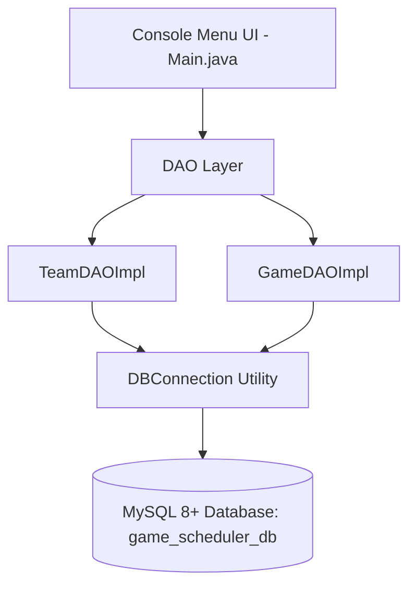

# Game Scheduler and Score Calculator

A production-grade, backend-only **Game Scheduler and Score Calculator** system built using **Core Java 21**, **JDBC**, and **MySQL 8+**.

---

## 📌 Architecture & Design Principles

The application strictly adheres to clean layered architecture separation:



### Layer Responsibilities

1. **`com.gamescheduler.model`**: POJOs representing core domain objects (`Team`, `Game`, `MatchResult`, `TeamStanding`, `GameStatus`).
2. **`com.gamescheduler.dao`**: Interface definitions and JDBC implementations (`TeamDAOImpl`, `GameDAOImpl`) encapsulating all SQL queries, `PreparedStatement` executions, and `ResultSet` mapping.
3. **`com.gamescheduler.util`**: Database connectivity provider (`DBConnection`) reading external `db.properties` configuration and validation utilities (`InputValidator`).
4. **`Main.java`**: Interactive CLI menu driving user interactions, business logic, score calculations, leaderboard standings, and input validations.

---

## 📊 Database Schema & Relationships (`database.sql`)

The MySQL database contains two primary tables linked via foreign key constraints:

### `teams` Table
- `team_id` (INT, Primary Key, Auto Increment)
- `team_name` (VARCHAR(100), UNIQUE, NOT NULL)
- `coach_name` (VARCHAR(100), NOT NULL)
- `created_at` (TIMESTAMP, Default CURRENT_TIMESTAMP)

### `games` Table
- `game_id` (INT, Primary Key, Auto Increment)
- `home_team_id` (INT, Foreign Key referencing `teams.team_id`)
- `away_team_id` (INT, Foreign Key referencing `teams.team_id`)
- `game_date` (DATE, NOT NULL)
- `game_time` (TIME, NOT NULL)
- `venue` (VARCHAR(150), NOT NULL)
- `home_score` (INT, Nullable until completed, CHECK `>= 0`)
- `away_score` (INT, Nullable until completed, CHECK `>= 0`)
- `status` (VARCHAR(20), NOT NULL: `'SCHEDULED'`, `'COMPLETED'`, `'CANCELLED'`)

### Key Database Rules
- **Foreign Keys**: `ON DELETE RESTRICT` ensures teams cannot be deleted while active games exist.
- **Constraints**:
  - `CHECK (home_team_id <> away_team_id)`: Prevents a team from playing against itself.
  - `CHECK (home_score >= 0 AND away_score >= 0)`: Ensures scores cannot be negative.
- **Indexes**: Indexed on `(game_date, game_time)`, `home_team_id`, `away_team_id`, and `status`.

---

## ⚽ Automatic Score Calculator Rules

Score evaluation occurs automatically when scores are submitted for a game:
- **Home Score > Away Score**: Home Team wins (`HOME_WIN`).
- **Away Score > Home Score**: Away Team wins (`AWAY_WIN`).
- **Home Score == Away Score**: Match ends in a draw (`DRAW`).

---

## 🏆 Multi-Tier Leaderboard Sorting Algorithm

Leaderboard standings are compiled strictly from `COMPLETED` games:
1. **League Points (PTS)**: Win = 3 points, Draw = 1 point, Loss = 0 points.
2. **Score Difference (GD)**: `Points Scored - Points Conceded`.
3. **Points Scored (GF)**: Total points/goals scored across completed matches.
4. **Team Name**: Alphabetical ascending order (`A-Z`).

---

## 🚀 Setup & Execution Guide

### 1. Prerequisites
- **JDK 21** or higher.
- **MySQL Server 8.0+** running on `localhost:3306`.
- **IntelliJ IDEA** (or standard Java IDE).

### 2. Database Initialization
Execute `database.sql` on your MySQL server:
```bash
mysql -u root -p < database.sql
```
Alternatively, open `database.sql` in MySQL Workbench or DBeaver and run the script.

### 3. Database Credentials Configuration
Open `src/main/resources/db.properties` and update your MySQL connection parameters:
```properties
db.url=jdbc:mysql://localhost:3306/game_scheduler_db?useSSL=false&allowPublicKeyRetrieval=true&serverTimezone=UTC
db.user=your_mysql_username
db.password=your_mysql_password
db.driver=com.mysql.cj.jdbc.Driver
```

### 4. Running the Console Application in IntelliJ IDEA
1. Open IntelliJ IDEA.
2. Select **File -> Open...** and select the project directory (`c:/Users/Dell/Downloads/game`).
3. Set **Project SDK** to **Java 21** under **File -> Project Structure -> Project**.
4. Verify the `lib/` directory is added under **File -> Project Structure -> Libraries** (or **Modules -> Dependencies**).
5. Navigate to `src/main/java/com/gamescheduler/Main.java`.
6. Right-click `Main.java` and select **Run 'Main.main()'**.

### 5. Running Tests in IntelliJ IDEA
1. In the Project Explorer, expand `src/test/java`.
2. Right-click on `src/test/java` (or any test class inside `com.gamescheduler`) and select **Run 'All Tests'**.


---

## 🧪 Unit Testing Coverage

The test suite in `src/test/java/com/gamescheduler/` includes 27 decoupled unit tests:
- **`ScoreCalculatorServiceTest`**: Validates home win, away win, draw, negative score rejection, and cancelled game score entry prevention.
- **`LeaderboardServiceTest`**: Validates 4-tier leaderboard sorting, points calculation, score difference, and non-inclusion of scheduled/cancelled games.
- **`TeamServiceTest`**: Validates duplicate team name rejection (case-insensitive) and team deletion constraints.
- **`GameServiceTest`**: Validates self-play prevention, overlapping match checks, and game cancellation logic.
- **`InputValidatorTest`**: Validates date (`YYYY-MM-DD`) and time (`HH:MM`) format parsers.

---

## 🎓 Viva & Project Demonstration Notes

During project evaluation or viva presentations:
1. **Layered Architecture**: Explain how `Main.java` delegates to `Service` classes, which rely on `DAO` interfaces for database interactions using `PreparedStatement` to prevent SQL Injection.
2. **Business Rules**: Explain how `GameService` prevents overlapping games by querying date & time for either home or away teams.
3. **Database Integrity**: Highlight MySQL foreign keys, NOT NULL constraints, CHECK constraints, and unique indexes on team names.
